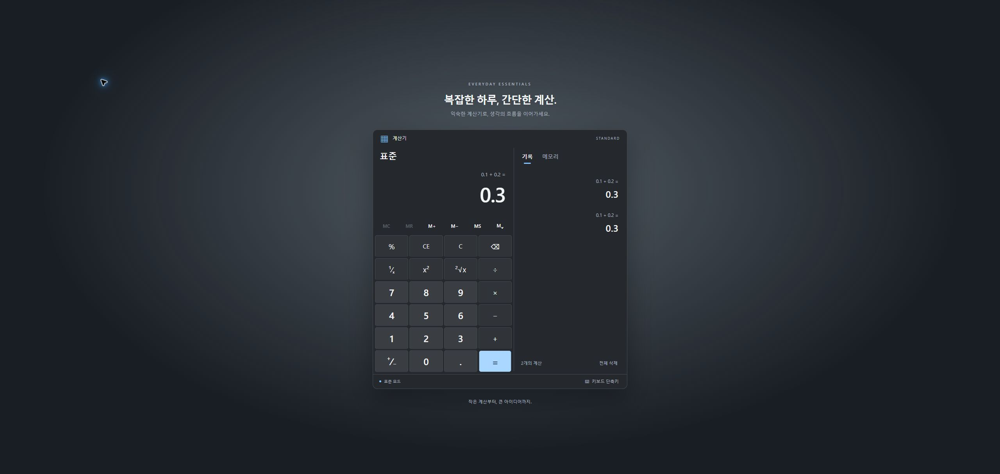

# Windows 표준 계산기 · React

React 18 + TypeScript + Vite로 구현한 Windows 스타일 표준 계산기입니다. 제공된 [intent](docs/intent.md), [spec](docs/spec.md), [plan](docs/plan.md)을 기준으로 작성했습니다.



## 실행

Node.js 22.12 이상 권장. 프로젝트 폴더에서 실행합니다.

```sh
npm ci
npm run dev
```

개발 주소: http://127.0.0.1:5173 (포트가 사용 중이면 Vite가 다음 포트를 표시합니다.)

```sh
npm test                 # 엔진·상태·컴포넌트 테스트
npm run test:coverage    # 커버리지
npm run lint             # ESLint
npm run build            # TypeScript 검사 및 dist 생성
npm run preview          # 배포 빌드 로컬 확인
```

## 기능

- 사칙연산을 입력 순서대로 즉시 실행, 연산자 교체, 반복 등호
- 역수, 제곱, 제곱근, 백분율, 부호 전환, CE/C/Backspace
- decimal.js 정밀도 32, 입력 16자리 및 결과 16 유효숫자
- 메모리 MC/MR/M+/M−/MS 및 저장 값 패널
- 최신순 계산 기록 최대 100개, 결과 불러오기와 전체 삭제
- 메모리·기록 localStorage 저장과 손상 데이터 복구
- 숫자·연산 키, Enter, Delete, Escape 및 복사/붙여넣기
- 시스템 설정을 따르는 라이트/다크 테마, 320px 대응, 결과 읽기 및 포커스 링

단축키 전체 목록은 앱 하단의 **키보드 단축키**에서 확인할 수 있습니다. 브라우저가 예약한 Ctrl 단축키는 브라우저에 따라 앱에 전달되지 않을 수 있습니다. 클립보드는 localhost 또는 HTTPS 환경에서 브라우저 권한이 허용되어야 작동합니다.

## 구조

`src/engine`은 React와 DOM에 의존하지 않는 순수 함수입니다. `src/state/calcReducer.ts`는 계산 상태 전이만 처리하고, Context에서 기록 UUID·시각을 생성합니다. `src/hooks`는 키보드와 저장소 부수효과를 담당하고 `src/components`는 화면을 구성합니다. 구현 중 확정한 세부 동작은 spec 12장에 기록했습니다.

## 검증

- 명세에 실제로 정의된 38개 시나리오(S01–S10, S20–S28, S30–S37, S40–S45, S50–S54)를 모두 테스트로 옮겼습니다.
- 기본 연산, 오류 복구, 입력 제한, 반복 계산, 메모리, 기록, 클립보드, 저장 복원 테스트를 포함합니다.
- Chrome에서 소수 연산과 320px 화면의 16자리 표시 및 기록 패널을 확인했습니다.
- Windows 기본 계산기와의 전수 대조, Lighthouse 점수 측정, NVDA 및 타 브라우저의 수동 검증은 수행하지 않았습니다. 외부 배포는 하지 않았습니다.

## 구현 메모

표시 문자열과 수식용 단항 연산 문자열을 분리해 `5 + sqr(3) =`처럼 피연산자 표현을 보존했습니다. reducer에 시간·난수 생성을 넣지 않아 같은 상태와 액션으로 같은 결과를 재현할 수 있습니다. 정밀도와 표현 형식의 경계, 연산 직후 새 입력, 깨진 저장 데이터는 별도 테스트로 검증합니다.
